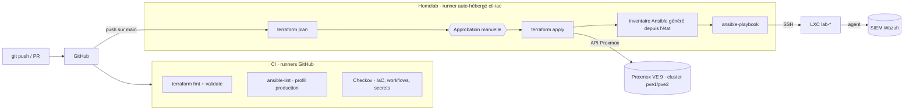

# homelab-iac

Infrastructure de mon homelab **Proxmox VE** gérée as code : **Terraform** crée les conteneurs, **Ansible** les configure et les durcit, **GitHub Actions** contrôle, scanne et déploie, avec une approbation manuelle avant toute modification.

Le principe : traiter un homelab comme un environnement régulé. Aucune modification à la main, tout passe par Git, une revue du plan, un scan de sécurité et une validation explicite.

## Architecture



## Ce que fait le dépôt

| Brique | Rôle | Fichiers |
|---|---|---|
| Terraform | Crée les LXC Debian non privilégiés (provider `bpg/proxmox`), IP fixe, clé SSH, tags | `terraform/` |
| Ansible | Socle commun (mises à jour, paquets, fuseau, mises à jour de sécurité auto), durcissement SSH, enrôlement automatique dans le SIEM Wazuh | `ansible/` |
| CI | `terraform fmt/validate`, `ansible-lint` (profil *production*), scan Checkov | `.github/workflows/ci.yml` |
| CD | Plan → approbation → apply → Ansible, sur un runner auto-hébergé dans le homelab | `.github/workflows/deploy.yml` |

## Sécurité et conformité dès la conception

- **Aucun secret dans Git** : le token API Proxmox est un secret GitHub, injecté en variable d'environnement ; l'état Terraform reste dans le homelab.
- **Moindre privilège** : utilisateur Proxmox dédié `terraform@pve` avec un rôle limité, sans accès root.
- **Séparation des responsabilités** : les contrôles tournent sur les runners GitHub ; seul le déploiement, déclenché depuis `main`, s'exécute dans le homelab. Les pull requests externes ne peuvent pas l'atteindre.
- **Approbation obligatoire** : environnement GitHub `homelab` protégé ; le plan appliqué est exactement celui qui a été validé (fichier de plan, pas de re-planification).
- **Traçabilité** : chaque changement = un commit, une PR, un plan visible dans le résumé du pipeline, une approbation horodatée.
- **Chaîne d'approvisionnement** : actions GitHub épinglées par SHA, mises à jour via Dependabot ; provider Terraform à version figée.
- **Gouvernance** : conventions validées par le code (IDs 300–399 réservés à Terraform, IP en CIDR, template obligatoire).
- **Idempotence** : un second passage d'Ansible ne modifie rien (`changed=0`), ce qui permet de détecter et corriger toute dérive de configuration.

## Utilisation (depuis `ctl-iac`)

```bash
make help        # liste des commandes
make plan        # ce qui va changer
make deploy      # apply + configuration Ansible
make check       # mêmes contrôles que la CI
```

Mise en place pas à pas : [docs/GUIDE.md](docs/GUIDE.md).

## Évolutions prévues

- Backend d'état distant (S3 compatible / MinIO) avec verrouillage
- Module Azure (`azurerm`) : resource group, VNet, stockage
- Rôle Docker et déploiement d'une application conteneurisée
- Tests d'infrastructure (Molecule) et détection de dérive planifiée
